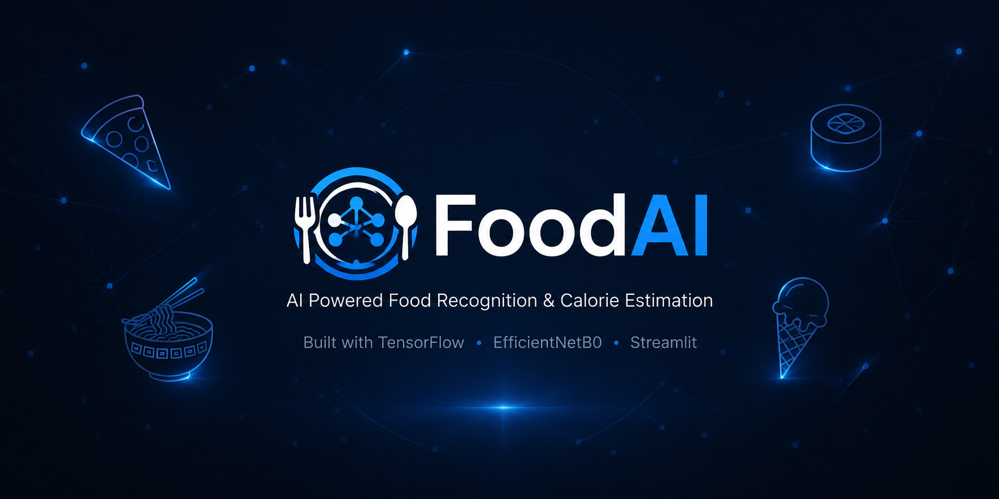
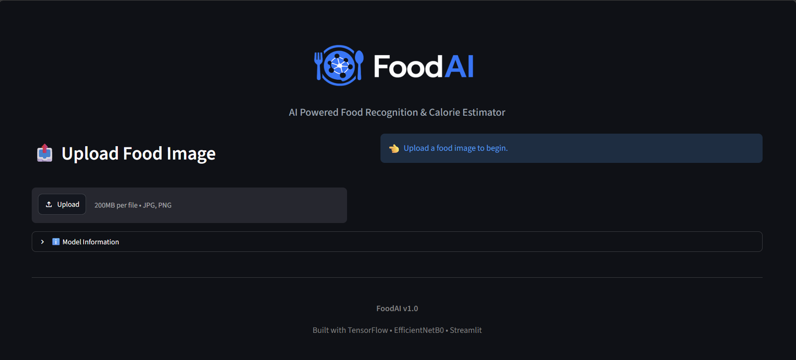
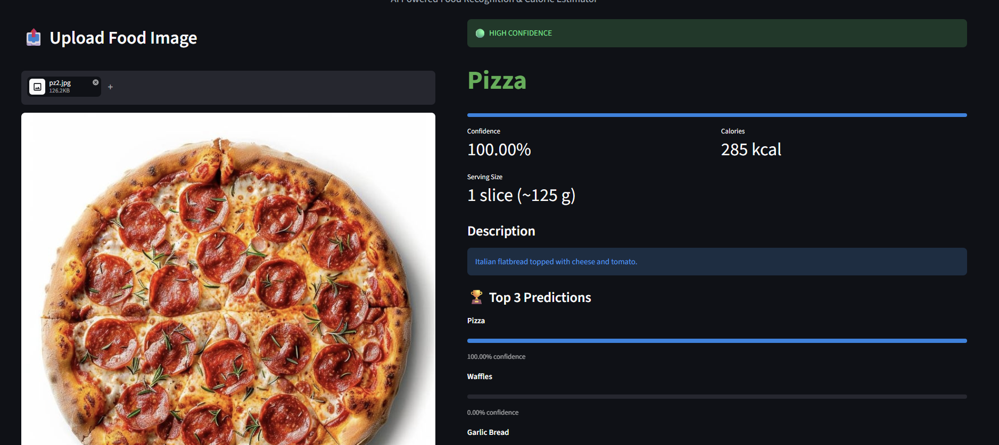

# 🍽️ FoodAI

<p align="center">
  
</p>

<p align="center">


</p>

<p align="center">
<b>AI Powered Food Recognition & Calorie Estimator</b>
</p>

---

## 📖 Overview

FoodAI is a deep learning application that identifies food items from an uploaded image and provides nutritional information including estimated calories, serving size, confidence score, and the top three predictions.

The project is powered by **TensorFlow EfficientNetB0** and deployed using **Streamlit** with a clean, interactive web interface.

---

## ✨ Features

* 🍕 Food Image Classification
* 🤖 EfficientNetB0 Deep Learning Model
* 📊 Confidence Score
* 🔥 Estimated Calories
* 🍽️ Serving Size Estimation
* 📝 Food Description
* 🏆 Top 3 Predictions
* 🌙 Modern Dark UI
* ⚡ Real-time Predictions
* 📱 Responsive Streamlit Interface

---

# 📸 Application Preview

## Home Page



---

## Prediction Example



---

## Model Information


---

# 🧠 Model Architecture

| Component  | Details            |
| ---------- | ------------------ |
| Model      | EfficientNetB0     |
| Framework  | TensorFlow / Keras |
| Interface  | Streamlit          |
| Language   | Python             |
| Input Size | 224 × 224          |
| Output     | 20 Food Categories |

---

# 📊 Performance

| Metric              |          Value |
| ------------------- | -------------: |
| Validation Accuracy |     **85.28%** |
| Classes             |         **20** |
| Architecture        | EfficientNetB0 |

---

# 🍽️ Supported Food Categories

* Baklava
* Cheesecake
* Donuts
* French Fries
* Fried Rice
* Garlic Bread
* Grilled Cheese Sandwich
* Hot & Sour Soup
* Ice Cream
* Nachos
* Onion Rings
* Pancakes
* Pizza
* Ramen
* Red Velvet Cake
* Samosa
* Spring Rolls
* Sushi
* Tacos
* Waffles

---

# ⚠️ Model Limitations

FoodAI is a **closed-set image classifier**.

It has been trained only on the 20 food categories listed above.

If an image outside these categories (such as burgers, biryani, coffee, pasta, sandwiches, etc.) is uploaded, the model predicts the closest matching supported class. Such predictions may have low confidence and should not be considered accurate.

---

# 📂 Project Structure

```text
FoodAI/
│
├── assets/
├── components/
├── models/
├── screenshots/
├── reports/
│
├── app.py
├── predict_food.py
├── food_database.py
├── train_model.py
├── config.py
├── requirements.txt
└── README.md
```

---

# ⚙️ Installation

Clone the repository

```bash
git clone https://github.com/tanishqbhorpe/FoodAI.git
```

Go to the project directory

```bash
cd FoodAI
```

Create a virtual environment

```bash
python -m venv .venv
```

Activate it

Windows

```bash
.venv\Scripts\activate
```

Install dependencies

```bash
pip install -r requirements.txt
```

Run the application

```bash
streamlit run app.py
```

---

# 🚀 Technologies Used

* Python
* TensorFlow
* Keras
* EfficientNetB0
* Streamlit
* Pillow
* NumPy

---

# 🔮 Future Improvements

* Support 100+ food categories
* Object detection for multiple foods
* Portion size estimation using computer vision
* Nutritional breakdown (Protein, Carbs, Fat)
* Barcode scanning
* Mobile application
* Cloud deployment

---

# 👨‍💻 Author

**Tanishq Bhorpe**

Machine Learning & AI Engineering Student

GitHub: https://github.com/tanishqbhorpe

---

## ⭐ If you found this project interesting, consider giving it a Star!
